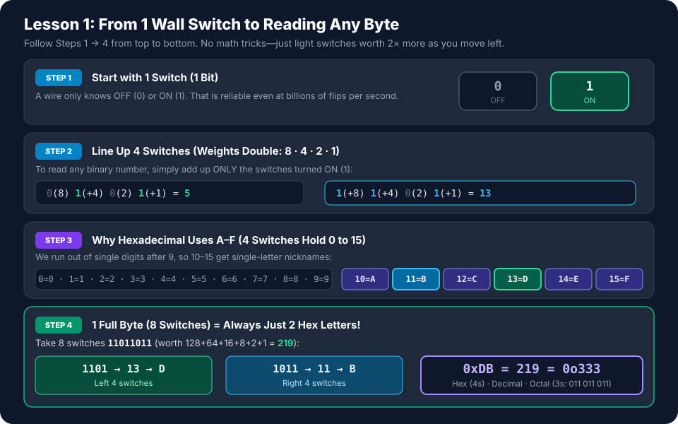
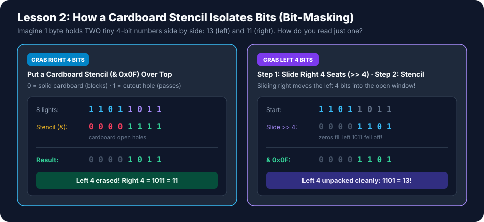
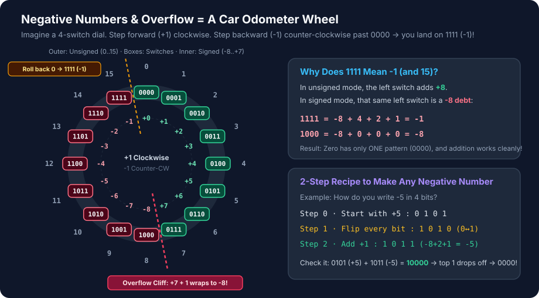
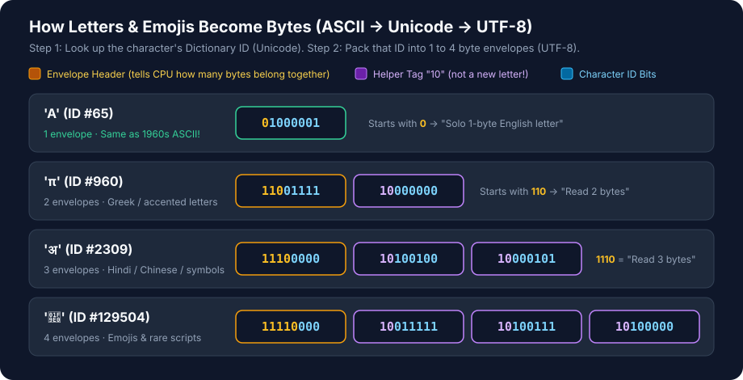

# Chapter 1: Binary, Hex, Two's Complement, Overflow, ASCII & UTF-8

> **Module:** `M0.1` Computer Architecture & Silicon Foundations · **Phase 0:** Silicon, OS, Compilers & Systems Programming  
> **Interactive Live Lesson (Play / Pause / Step-by-Step + Multi-View Clean/Editorial/Product/Swiss):** Open [`assets/ch01-live-lesson.html`](./assets/ch01-live-lesson.html) · **Narrated AI Tutor Video (3m 33s MP4 w/ Indian-English Audio):** Watch [`assets/ch01-infographic-video.mp4`](./assets/ch01-infographic-video.mp4)

---

## Start Here: Why Computers Only Use `0` and `1`

Imagine a light switch on your wall. It only has two reliable states:
- **OFF** = `0`
- **ON** = `1`

Could you build a switch with 10 dim levels (`0` through `9`)? Technically yes, but electrical noise makes level 6 look like level 7. Two states (`ON` and `OFF`) are rock solid, even when billions of tiny switches switch billions of times per second inside your CPU or GPU.

- **1 switch** = **1 bit** (*short for **BI**nary digi**T***: just `0` or `1`, the smallest atom of computer memory)
- **4 switches in a row** = **1 nibble** (`2⁴ = 16` combinations, `0` to `15` — fits neatly into 1 Hex digit!)
- **8 switches in a row** = **1 byte** (`2⁸ = 2×2×2×2×2×2×2×2 = 256` combinations, from `00000000` to `11111111`)

Here is the secret that unlocks all of systems engineering:

> **The computer does NOT know if `11011011` is a positive number, a negative number, or part of an emoji. The switches stay identical—only the rule you use to read them changes.**

---

## 1. Decimal, Binary, Octal, Hex & Bit-Masking

### How Counting Works (You Already Know Base 10!)

In normal **Decimal (base 10)**, every digit position is worth 10× more than the one on its right:
$$219 = (2 \times \mathbf{100}) + (1 \times \mathbf{10}) + (9 \times \mathbf{1})$$

In **Binary (base 2)**, every switch position is worth **2× more** than the one on its right:
`128 ← 64 ← 32 ← 16 ← 8 ← 4 ← 2 ← 1`

To read a binary number, just **add up the weights of the switches that are ON (`1`)**:
- `0101` = `0×8 + 1×4 + 0×2 + 1×1` = **`5`**
- `11011011` = `128 + 64 + 16 + 8 + 2 + 1` = **`219`**

### Why Do Octal and Hexadecimal Exist?

Try reading `1101101110101111` out loud without losing your place. Humans are terrible at long strings of `0`s and `1`s.

So programmers invented two compact nicknames by bundling switches together:
1. **Octal (base 8):** Bundle switches in **groups of 3** (`0` to `7`). Common in Linux file permissions (`chmod 755`).
2. **Hexadecimal / "Hex" (base 16):** Bundle switches in **groups of 4** (`0` to `15`). Since we run out of single digits after `9`, we use letters `A`–`F`:

| Value | 4 Switches | Hex | Value | 4 Switches | Hex |
| :---: | :---: | :---: | :---: | :---: | :---: |
| `0` | `0000` | `0` | `8` | `1000` | `8` |
| `1` | `0001` | `1` | `9` | `1001` | `9` |
| `2` | `0010` | `2` | `10` | `1010` | **`A`** |
| `3` | `0011` | `3` | `11` | `1011` | **`B`** |
| `4` | `0100` | `4` | `12` | `1100` | **`C`** |
| `5` | `0101` | `5` | `13` | `1101` | **`D`** |
| `6` | `0110` | `6` | `14` | `1110` | **`E`** |
| `7` | `0111` | `7` | `15` | `1111` | **`F`** |

Because **1 byte = 8 bits = two groups of 4**, **every single byte is always exactly 2 Hex characters** (like `0xDB`, where `0x` just means *"hey, this number is written in Hex"*).



### Bit-Masking = Putting a Cardboard Stencil Over Your Lights

Suppose 8 bits store **two small numbers packed side by side** (for example, two 4-bit AI weights inside 1 byte to save GPU memory):
`1101` (left number = `13`) and `1011` (right number = `11`).



How do you read **only the right 4 bits**?
Put a **cardboard stencil** over the 8 lights using `&` (**AND**):
- Put `0` where you want cardboard to **block** the light (`0 AND anything = 0`).
- Cut a `1` hole where you want the light to **pass through** (`1 AND bit = bit`).

```text
  Your byte :  1101 1011   (0xDB = 219)
& Stencil   :  0000 1111   (0x0F = "block left 4, keep right 4")
  ─────────────────────
  Result    :  0000 1011   (= 11!)
```

How do you read **only the left 4 bits**?
1. Slide all switches 4 seats to the right (`>> 4`), so `1101 1011` becomes `0000 1101` (the `1011` falls off the right edge).
2. Apply the same `0x0F` stencil (`& 0x0F`) $\rightarrow$ `13`!

### Quick Cheat Sheet of All 6 Bitwise Tools

| Symbol | Plain English Name | What It Does | Everyday Example |
| :---: | :--- | :--- | :--- |
| `&` | **AND** (Stencil / Filter) | Keeps a bit only if BOTH inputs are `1` | Keep low 4 bits: `x & 0x0F` |
| `\|` | **OR** (Glue / Turn ON) | Result is `1` if EITHER input is `1` | Glue two 4-bit numbers into 1 byte: `(a << 4) \| b` |
| `^` | **XOR** (Toggle Switch) | Result is `1` if the two bits are DIFFERENT | Flip switch #0: `x ^ 1` |
| `~` | **NOT** (Invert) | Flips every `0` to `1` and every `1` to `0` | `~0101` $\rightarrow$ `1010` |
| `<<` | **Left Shift** | Slides all bits left (multiplies by 2 each step) | `1 << 3` = `1000` (`8`) |
| `>>` | **Right Shift** | Slides all bits right (divides by 2 each step) | `11011011 >> 4` = `00001101` |

---

## 2. Negative Numbers, Two's Complement & Overflow

### Think About a Car Odometer

Imagine a 4-digit car odometer set to `0000`.
- Drive **forward** 1 mile: `0001`, `0002`, ..., `9999`.
- What if you drive **backward** 1 mile from `0000`? The wheels roll backward to **`9999`**!
- Drive backward 2 miles from `0000`? **`9998`**!

Notice something wild: `9999 + 1` rolls forward to `0000` (with the carry `1` falling off the left edge). That means inside a 4-digit wheel, **`9999` behaves identically to `-1`**!

**Two's complement** is the exact same odometer trick, just with `0`s and `1`s.



### Why Not Just Reserve the Leftmost Bit as a Minus Sign?

Beginners always ask: *"Why not just say `0` = positive and `1` = negative?"*
Because that simple idea breaks two things:
1. You get **two zeros**: `0000` (`+0`) and `1000` (`-0`). Now `if (a == b)` needs special extra wiring!
2. Addition breaks: `0001 (+1) + 1001 (-1)` would give `1010 (-2)` instead of `0`!

With **Two's Complement**, the leftmost bit doesn't act as a +/- flag — it simply has a **negative weight** (`-8` in 4 bits, `-128` in 8 bits). Because it's still normal place-value math, **the CPU uses the exact same addition circuit for both positive and negative numbers**.

### How to Flip Any Number's Sign in 2 Easy Steps (`-x = ~x + 1`)

Want to turn `+5` (`0101`) into `-5`?
1. **Flip every switch** (`0 ↔ 1`): `0101` $\rightarrow$ `1010`
2. **Add `1`**: `1010 + 1` $\rightarrow$ **`1011`**

Let's check: in 4-bit signed weights (`-8, +4, +2, +1`), `1011` = `-8 + 2 + 1 = -5`!  
And `0101 (+5) + 1011 (-5) = 10000` $\rightarrow$ the 5th bit falls off the 4-bit register $\rightarrow$ `0000` (`0`)!

### Integer Ranges & Wraparound Overflow

Because switches are finite, every box size has a hard ceiling and floor:

| Box Size | Unsigned Range (`0` up to...) | Signed Range (`-` up to `+`) |
| :---: | :--- | :--- |
| **4 bits** | `0` to `15` | `-8` to `+7` |
| **8 bits (1 byte)** | `0` to `255` | `-128` to `+127` |
| **16 bits (2 bytes)** | `0` to `65,535` | `-32,768` to `+32,767` |
| **32 bits (4 bytes)** | `0` to `4,294,967,295` | `-2,147,483,648` to `+2,147,483,647` |
| **64 bits (8 bytes)** | `0` to `1.84 × 10¹⁹` | `-9.22 × 10¹⁸` to `+9.22 × 10¹⁸` |

> **Why is `int8` `-128..+127` asymmetric (and why does `-(-128)` break)?** Because `0` sits on the non-negative half (`00000000`–`01111111`), leaving `10000000` (`-128`) with **no positive twin**. Flipping and adding 1 to `10000000` gives `01111111 + 1 = 10000000` (`-128` again)! In C/C++, signed integer overflow is *Undefined Behavior* (compilers assume it cannot happen), whereas unsigned integers wrap modulo `2ᴺ` deterministically.

**Overflow** happens when you step past the ceiling—just like Pac-Man walking off the right edge of the screen and popping out on the left:
- In 8-bit unsigned (`uint8`): `255 + 1` wraps silently to **`0`**. (Famous bug: Pac-Man's level counter was an 8-bit byte, so level `255 + 1` wrapped to `0` and scrambled the screen!)
- In 8-bit signed (`int8`): `+127 + 1` steps across the sign cliff (`01111111 + 1 = 10000000`) and becomes **`-128`**! (Famous bug: YouTube had to upgrade from 32-bit signed integers when *Gangnam Style* crossed 2.14 billion views!)

> **Why AI Engineers Care:** If you multiply two `int8` numbers like `100 × 100 = 10,000`, it **already overflows `int8`** (max `+127`). That is why quantized AI chips multiply `int8` numbers into a wide **`int32` bucket** before shrinking back down.

---

## 3. ASCII, Unicode & UTF-8 (How Letters & Emojis Work)

Computers still only store numbers (`0–255` per byte). To store text, everyone had to agree on a **secret decoder ring**: *"Whenever you see number `65`, draw the letter `'A'` on screen."*

### Step A: ASCII (1960s — English Only, 7 Bits)

Early American engineers picked `0` to `127` (**7 bits** inside an 8-bit byte, so the top bit was always `0`):
- `'A'` = `65` (`0x41` = `01000001`)
- `'a'` = `97` (`0x61` = `01100001`)
- `'0'` = `48` (`0x30` = `00110000`)

**The problem:** 128 slots could not fit accented European letters (`é`), Hindi (`अ`), Chinese (`中`), Arabic, or emojis (`🧠`).

### Step B: Unicode = The Master Dictionary ID (Not Bytes!)

**Unicode** solved this by creating one giant master catalog giving **every symbol on Earth its own unique ID number** (written `U+XXXX` in Hex):
- `'A'` $\rightarrow$ ID `#65` (`U+0041`)
- `'π'` $\rightarrow$ ID `#960` (`U+03C0`)
- `'अ'` $\rightarrow$ ID `#2309` (`U+0905`)
- `'🧠'` $\rightarrow$ ID `#129504` (`U+1F9E0`)

### Step C: UTF-8 = Variable-Size Envelopes (1 to 4 Bytes)

If we stored every character as a 4-byte number so emojis would fit, every English webpage and Python file would instantly become **4× larger**!

**UTF-8** fixed this with a clever envelope system:
- Common English characters (`0–127`) use **1 envelope (1 byte)** — **100% identical to old ASCII!**
- Larger IDs use **2, 3, or 4 envelopes**, and the **very first bits of Byte 1** tell the CPU how many envelopes belong together:



| First Byte Starts With... | Total Bytes | Used For... | Helper Bytes (`2nd, 3rd, 4th`) |
| :--- | :---: | :--- | :--- |
| **`0`...** | **1 byte** | English ASCII (`U+0000`–`U+007F`) | None |
| **`110`...** | **2 bytes** | Accented Latin, Greek, Arabic (`'π'`) | Always start with **`10`...** |
| **`1110`...** | **3 bytes** | Hindi, Chinese, Japanese, symbols (`'अ'`) | Always start with **`10`...** |
| **`11110`...** | **4 bytes** | Emojis & rare scripts (`'🧠'`) | Always start with **`10`...** |

Why is that **`10`...** helper tag genius? Because if you jump into the middle of a file and land on a byte starting with `10`, you immediately know: *"Oops, I'm in the middle of a multi-byte character—skip ahead until a byte NOT starting with `10`!"*

> **AI Connection (Why Emojis Cost More LLM Tokens):** GPT-4 and Llama tokenizers convert your prompt into **UTF-8 bytes first** (`'A'` = 1 byte, `'🧠'` = 4 bytes) before grouping common byte sequences into tokens.

---

## Try It Yourself in Python (Zero Setup)

Copy and run this in any terminal with `python`:

```python
import ctypes

# 1. Watch one number in 4 bases
n = 219
print("Binary:", bin(n))   # 0b11011011
print("Octal :", oct(n))   # 0o333
print("Hex   :", hex(n))   # 0xdb

# 2. Cardboard stencil (bit-mask) to unpack two 4-bit numbers from 219
right_4 = n & 0x0F
left_4  = (n >> 4) & 0x0F
print(f"Left 4 = {left_4}, Right 4 = {right_4}")  # 13, 11

# 3. Real 8-bit overflow (like a car odometer)
print("uint8(255 + 1) =", ctypes.c_uint8(255 + 1).value)  # wraps to 0
print("int8(127 + 1)  =", ctypes.c_int8(127 + 1).value)   # wraps to -128!

# 4. Unicode ID vs UTF-8 byte envelopes
for ch in ["A", "π", "अ", "🧠"]:
    b = ch.encode("utf-8")
    print(f"{ch} -> Unicode #{ord(ch)} (U+{ord(ch):04X}) -> {len(b)} byte(s): {b.hex(' ').upper()}")
```

---

## Check Your Intuition (Click to Reveal Answers)

<details>
<summary>1. Why are Hex numbers always written in pairs like <code>0x4F</code> or <code>0xDB</code>?</summary>

Because 1 Hex digit holds **4 bits**, so **2 Hex digits = 8 bits = 1 full byte**.

</details>

<details>
<summary>2. What happens if you start at <code>0000</code> on a 4-bit odometer and step backward by 1?</summary>

It rolls back to **`1111`**. In unsigned math that is `15`; in signed two's complement math that is **`-1`**.

</details>

<details>
<summary>3. Using the 2-step negation trick (<code>flip bits, add 1</code>), what is <code>-3</code> in 4 bits?</summary>

Start with `+3` = `0011` $\rightarrow$ flip bits = `1100` $\rightarrow$ add `1` = **`1101`**. Check: `-8 + 4 + 0 + 1 = -3`!

</details>

<details>
<summary>4. How many UTF-8 bytes does the English word <code>"Hi"</code> take vs one emoji <code>"🧠"</code>?</summary>

`"Hi"` takes **2 bytes** (1 byte per ASCII letter). `"🧠"` alone takes **4 bytes**!

</details>
