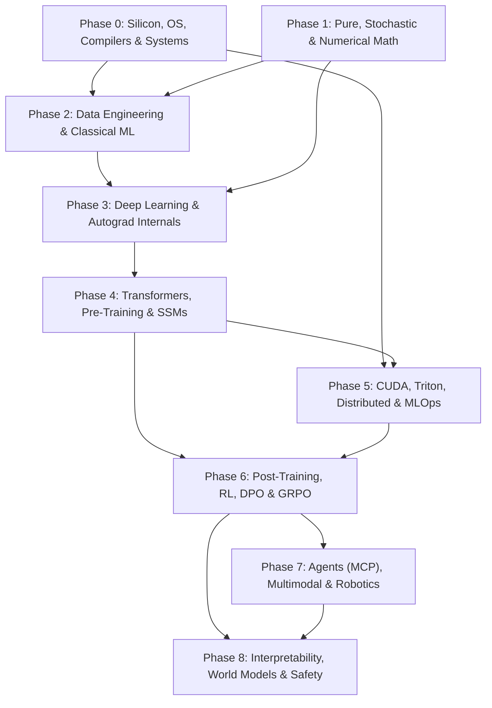

# 🧠 The Complete AI, Systems & Frontier Intelligence Roadmap

> 2. Open live roadmap at `https://shashankshawak7.github.io/AI-Learning-Journey/` (or open [`docs/index.html`](./docs/index.html) locally in any browser).

---

## 🗺️ Dependency Architecture

---

## 📚 Exhaustive Phase & Module Syllabus

<strong>Phase 0: Silicon, OS, Compilers & Systems Programming</strong> (10–14 Weeks · Prereq: None)

> **Mental Model:** Intelligence is ultimately electricity moving bits through caches and ALUs. Before you abstract compute, understand cache lines, memory alignment, compilers, and lock-free concurrency.

### `M0.1` Computer Architecture & Silicon Foundations
_Why memory bandwidth—not FLOPs—bottlenecks modern AI._

- [ ] Binary, Hex, Two's complement, Overflow, ASCII & UTF-8
  - Decimal, binary, octal, and hexadecimal base conversions & bit-masking
  - Unsigned vs signed integer ranges, two's complement bit negation, and wraparound overflow
  - ASCII 7-bit encoding vs Unicode code points and variable-width UTF-8 byte sequences
- [ ] Boolean Algebra, Logic Gates & IEEE 754 Floats (FP32/16/BF16/FP8/NVFP4)
  - Boolean algebra identities, De Morgan's laws, NAND/NOR universal gates, half/full adders
  - IEEE 754 sign, exponent, and mantissa bit splits across FP32 (8+23), FP16 (5+10), BF16 (8+7)
  - Subnormals, Inf/NaN bit patterns, dynamic range vs precision tradeoffs in FP8 (E4M3/E5M2) & NVFP4
- [ ] CPU ALU, Registers, Machine Instructions & Assembly
  - Arithmetic Logic Unit (ALU), control unit, program counter, and fetch-decode-execute cycle
  - General-purpose vs vector registers, calling conventions, stack frames, and x86-64 / ARM64 assembly
- [ ] Pipelining, Branch Prediction, Out-of-Order & SIMD (AVX-512/NEON)
  - Instruction pipelining hazards (data, control, structural) and speculative branch prediction
  - Out-of-Order execution, reorder buffers, and SIMD vectorization (AVX-512 / ARM NEON)
- [ ] L1/L2/L3 Cache Lines, Cache Misses & False Sharing
  - SRAM L1/L2/L3 cache latency hierarchy, 64-byte cache lines, spatial & temporal locality
  - Compulsory, capacity, and conflict misses; multi-core false sharing & cache-line padding
- [ ] Virtual Memory, Page Tables, TLB & NUMA
  - Page tables, Translation Lookaside Buffer (TLB) hits/misses, hugepages, and page faults
  - NUMA (Non-Uniform Memory Access) socket pinning and cross-socket bandwidth penalties
- [ ] Von Neumann vs Harvard Architectures
  - Unified instruction/data bus (Von Neumann bottleneck) vs split instruction/data paths (Harvard)
  - How modern modified-Harvard CPUs & systolic NPUs bypass memory walls
- [ ] PCIe Gen4/5/6, NVLink, Infinity Fabric, CXL
  - PCIe lane bandwidth limits (host-to-device bottlenecks) vs NVLink / NVSwitch chip-to-chip fabrics
  - Compute Express Link (CXL) memory pooling and cache-coherent CPU-accelerator sharing
- [ ] **[Frontier]** FP8 / NVFP4 hardware formats
  - Microscaling (MXFP8 / NVFP4) block-wise scale factors on Hopper & Blackwell Tensor Cores
  - E4M3 (forward pass precision) vs E5M2 (gradient dynamic range) mixed-precision selection
- [ ] **[Frontier]** CXL cache-coherent memory
  - CXL.mem and CXL.cache protocols for expanding KV-cache capacity beyond HBM limits
  - Tiered memory paging architectures between GPU HBM, host DDR5, and CXL pools

### `M0.2` Operating Systems, Compilers & IR Lowering
_How high-level Python tensor code lowers to machine instructions._

- [ ] Processes, Threads, Interrupts & System Calls (mmap, epoll, futex)
- [ ] Kernel vs User Space, Context Switching
- [ ] Atomics, Memory Barriers, Mutexes & Lock-Free Queues
- [ ] Async I/O (io_uring), Zero-Copy Networking (DPDK)
- [ ] Lexing, Parsing, ASTs & Static Single Assignment (SSA)
- [ ] Compiler vs Interpreter vs JIT Virtual Machines
- [ ] MLIR, LLVM IR, Loop Tiling, Operator Fusion & Graph Lowering
  - Multi-Level IR (MLIR) dialects (linalg, tensor, scf, gpu) and progressive lowering passes
  - Polyhedral loop tiling, vectorization, memory-bound operator fusion, and LLVM backend codegen
- [ ] **[Frontier]** MLIR & AI Compiler Passes (TVM / XLA)
- [ ] **[Frontier]** io_uring async disk-to-GPU streaming

### `M0.3` Python Mastery & Systems Programming (C, C++, Rust)
_Python is your control plane; C++/Rust/CUDA is your execution plane._

- [ ] Python Core: OOP, Dataclasses, Decorators, Generators, Context Managers
  - Classes, inheritance, MRO, polymorphism, ABCs, dataclasses, enums, and descriptor protocol
  - Closures, decorators, lazy generator pipelines (`yield`), and `__enter__`/`__exit__` context managers
- [ ] Python Internals: GIL, AsyncIO, Memory/GC, Type Hints & Protocols
- [ ] Python Tooling: uv, pytest, mypy, Ruff & Packaging Architecture
- [ ] C Pointers, Manual Allocation, Alignment & Bitfields
- [ ] C++20 RAII, Move Semantics, Templates, Smart Pointers
- [ ] Rust Ownership, Lifetimes, Fearless Concurrency & Unsafe
- [ ] FFI Extensions: ctypes, pybind11, nanobind, PyO3
- [ ] **[Frontier]** Free-threaded Python (no-GIL 3.13+)
- [ ] **[Frontier]** nanobind & PyO3 zero-copy buffers

### `M0.4` Data Structures, Algorithms & Complexity
_Exact algorithmic intuition for vector search, graph routing, and beam search._

- [ ] Dynamic Arrays, Hash Tables, Tries, Suffix Trees
- [ ] AVL / Red-Black Trees, Heaps, Priority Queues, Union-Find
- [ ] Graphs: BFS, DFS, Topological Sort, Dijkstra, A*, MST
- [ ] Dynamic Programming, Greedy, Backtracking, Branch & Bound
- [ ] Probabilistic Structures: Bloom Filters & Count-Min Sketch
- [ ] Approximate Nearest Neighbors (HNSW, IVF-PQ)
- [ ] Parallel & Distributed Algorithms, NP-Completeness
- [ ] **[Frontier]** DiskANN & billion-scale graph indexing

> 🛠️ **Build Gate Capstone:** Build a zero-dependency C++/Rust Tensor runtime with a custom arena allocator, lock-free thread pool, SIMD matmul, and PyO3 Python bindings.

<strong>Phase 1: Pure, Stochastic & Computational Mathematics</strong> (10–12 Weeks · Prereq: High School Math)

> **Mental Model:** Deep learning is geometry in high-dimensional spaces paired with stochastic optimization. Master how vectors rotate, gradients flow, and probability measures shift.

### `M1.1` Discrete Math, Logic & Proof Systems
_The formal grammar underlying neuro-symbolic AI and theorem provers._

- [ ] Propositional & Predicate Logic, Quantifiers
- [ ] Direct, Contradiction & Mathematical Induction Proofs
- [ ] Set Theory, Relations, Equivalence Classes & Lattices
- [ ] Combinatorics, Permutations, Generating Functions
- [ ] Graph Theory, Trees, Planarity & Recurrence Relations
- [ ] Computability, Lambda Calculus & Turing Completeness
- [ ] **[Frontier]** Dependent Type Theory (Lean 4 foundations)

### `M1.2` Linear Algebra & Tensor Matrix Calculus
_Every neural layer is an affine map + nonlinearity; backprop is Jacobian chaining._

- [ ] Vector Spaces, Basis, Rank-Nullity, Projections
- [ ] Eigenvalues, Spectral Theorem & Diagonalization
- [ ] SVD, Pseudoinverse, QR, LU & Cholesky Factorizations
  - Full vs thin SVD, geometric interpretation (rotate-stretch-rotate), and Moore-Penrose pseudoinverse
  - QR (Gram-Schmidt / Householder), LU pivoting, and Cholesky ($LL^T$) for positive-definite covariance matrices
- [ ] Covariance Matrices, PCA & Low-Rank Approximations
- [ ] Tensor Algebra, Einsum Contractions, Kronecker Products
- [ ] Matrix Calculus: Jacobians, Hessians & Matrix Gradients
- [ ] **[Frontier]** Low-rank tensor decompositions (CP / Tucker)
- [ ] **[Frontier]** Conditioning in deep width limits

### `M1.3` Calculus, Differential Equations & Optimization Theory
_Training is descending noisy non-convex valleys; diffusion is reversing SDEs._

- [ ] Multivariable Chain Rule, Taylor Series & Saddle Points
- [ ] Convex Sets, Jensen's Inequality, Subgradients
- [ ] Constrained Optimization: Lagrangians, KKT Conditions, ADMM
- [ ] Newton, Quasi-Newton (BFGS, L-BFGS), Conjugate Gradient
- [ ] Stochastic Optimization: SGD, Momentum, AdamW, Muon, Lion
- [ ] ODEs, PDEs, Neural ODEs & Continuous Normalizing Flows
- [ ] Stochastic Calculus: Brownian Motion, Ito's Lemma & SDEs
  - Wiener processes, quadratic variation, Ito's Lemma, and forward/reverse-time SDEs
  - Probability flow ODEs linking diffusion noise schedules to continuous normalizing flows
- [ ] **[Frontier]** SDEs & Flow Matching for Diffusion
- [ ] **[Frontier]** Second-order / Muon matrix optimizers

### `M1.4` Probability, Information Theory & Numerical Computing
_Loss functions are information-theoretic divergences disguised as code._

- [ ] Bayes' Theorem, Exponential Families & Conjugate Priors
- [ ] MLE, MAP, Fisher Information, Cramér-Rao Bound
- [ ] LLN, Central Limit Theorem, Concentration Inequalities
- [ ] MCMC, Metropolis-Hastings, Gibbs & Variational Inference
- [ ] Entropy, Cross-Entropy, KL / JS Divergence, Mutual Info
- [ ] Information Bottleneck & Information Geometry (Natural Grad)
- [ ] BLAS/LAPACK, Numerical Stability, Log-Sum-Exp, Cancellation
- [ ] **[Frontier]** Information Geometry & Fisher-Rao metrics
- [ ] **[Frontier]** Reproducible deterministic floating-point

> 🛠️ **Build Gate Capstone:** Build a pure NumPy scientific optimization & ODE/SDE solver implementing SVD, Cholesky, L-BFGS, and AdamW from first principles.

<strong>Phase 2: Data Engineering, Classical ML & Learning Theory</strong> (8–10 Weeks · Prereq: Phase 0 + Phase 1)

> **Mental Model:** Models are only as clean as the tokens and tables you feed them. Master tabular baselines and causal structure before reaching for billion-parameter hammers.

### `M2.1` Large-Scale Data Engineering & Data-Centric AI
_Garbage in, garbage out—at 15 trillion tokens, data curation IS the secret sauce._

- [ ] Parquet, Arrow, ORC, Avro, Zstd Compression
- [ ] SQL Query Plans, B-Trees, LSM-Trees, DuckDB & Polars
- [ ] Spark (Catalyst, Shuffles), Kafka Streaming, Airflow/Dagster
- [ ] Data Lakes, Warehouses, Iceberg / Delta Lakehouse
- [ ] Entity Resolution, MinHash LSH & SemDeDup Deduplication
  - Shingling, MinHash signatures, and Locality Sensitive Hashing (LSH) for near-duplicate web filtering
  - Embedding clustering and semantic deduplication (SemDeDup) to boost pre-training sample efficiency
- [ ] Weak Supervision (Snorkel), Active Learning, Inter-Annotator Agreement
- [ ] Data Lineage, DVC Versioning, Licensing, PII & Decontamination
- [ ] **[Frontier]** Web-scale synthetic data flywheels
- [ ] **[Frontier]** Semantic deduplication (SemDeDup)

### `M2.2` Classical Machine Learning & Tabular SOTA
_On structured tabular data, well-tuned GBDTs still destroy deep nets._

- [ ] Ridge, Lasso, ElasticNet, Logistic Regression (IRLS), Naive Bayes & KNN
- [ ] SVMs, Dual Formulations, Kernel Trick, Gaussian Processes
- [ ] Decision Trees, Random Forests, Extra Trees & Ensembles (Stacking/Blending)
- [ ] Gradient Boosting: XGBoost, LightGBM, CatBoost Internals
- [ ] Clustering: K-Means++, GMM / EM, DBSCAN, HDBSCAN & Apriori/FP-Growth
- [ ] Dim Reduction: PCA, t-SNE, UMAP; Anomaly: Isolation Forest, One-Class SVM
- [ ] Time-Series (ARIMA, Temporal Fusion) & RecSys (Two-Tower, DLRM)
- [ ] Feature Selection, Calibration, Class Imbalance & Bayesian Hyperopt
- [ ] **[Frontier]** TabPFN in-context tabular transformers
- [ ] **[Frontier]** Two-tower retrieval & DLRM scaling

### `M2.3` Statistical Learning Theory & Causal Inference
_Why overparameterized networks generalize and why correlation fools agents._

- [ ] ERM, SRM, PAC Learning, VC Dimension, Rademacher Complexity
- [ ] Bias-Variance Tradeoff, No Free Lunch, Double Descent
- [ ] Benign Overfitting & Implicit Regularization
- [ ] Distribution Shift: Covariate, Label & Concept Drift
- [ ] Pearl's Causal Hierarchy, SCMs, DAGs, d-Separation
- [ ] Do-Calculus, Instrumental Variables, Counterfactuals & CATE
- [ ] **[Frontier]** Double descent & scaling regime transitions
- [ ] **[Frontier]** Causal representation learning

> 🛠️ **Build Gate Capstone:** Build a 50GB+ Polars/Spark pipeline with MinHash deduplication, custom GBDT engine from scratch, causal uplift checks, and exact SHAP attribution.

<strong>Phase 3: Deep Learning Foundations & Autograd Internals</strong> (8–10 Weeks · Prereq: Phase 1 + Phase 2)

> **Mental Model:** There is no magic in PyTorch—just a dynamic DAG recording tensor ops so the chain rule can walk backward via Vector-Jacobian Products.

### `M3.1` Neural Networks From First Principles
_Understanding signal propagation, variance preservation, and gradient highways._

- [ ] Perceptrons, MLPs, Universal Approximation Theorem
- [ ] Activations: ReLU, GeLU, SiLU, SwiGLU, Softmax Stability
- [ ] Losses: Cross-Entropy, MSE, Huber, Focal, InfoNCE, CTC
- [ ] Backprop Chain Rule, Vanishing/Exploding Gradients
- [ ] Init Theory: Xavier/Glorot, He/Kaiming, μP (Maximal Update Param)
- [ ] Norms: BatchNorm, LayerNorm, RMSNorm, GroupNorm
- [ ] Regularization: Dropout, Weight Decay, Residual Connections, Early Stopping
- [ ] **[Frontier]** μP (Maximal Update Parametrization) hyperparameter transfer

### `M3.2` PyTorch, JAX & Deep Learning Compiler Internals
_Strides, views, dispatchers, and graph compilation separate pros from API callers._

- [ ] Tensors: Storage, Strides, Contiguous Layouts & Broadcasting
- [ ] Forward-Mode (Dual Numbers) vs Reverse-Mode Autodiff (VJP)
  - Jacobian-Vector Products (JVP) with dual numbers vs Vector-Jacobian Products (VJP) adjoint graphs
  - Memory vs compute tradeoffs: checkpointing / rematerialization in deep computation DAGs
- [ ] Custom torch.autograd.Function & C++/CUDA Extensions
- [ ] Mixed Precision (AMP / BF16), Grad Scaling & Checkpointing
- [ ] torch.compile, TorchDynamo, AOTAutograd & TorchInductor
- [ ] JAX Functional Transforms: jit, vmap, pmap, shard_map & XLA
- [ ] **[Frontier]** TorchInductor Triton codegen
- [ ] **[Frontier]** JAX shard_map SPMD execution

### `M3.3` Foundational Vision, Sequence, Graph & Generative Nets
_Inductive biases before attention unified everything._

- [ ] CNNs, Depthwise Separable Convs, ResNet, ConvNeXt, U-Net
- [ ] Object Detection (YOLO, Faster R-CNN) & Segmentation (Mask R-CNN)
- [ ] RNNs, BPTT, LSTMs, GRUs, Bidirectional Sequence Models
- [ ] Graph Neural Networks: GCN, GAT, MPNN, E(n)-Equivariant GNNs
- [ ] Autoencoders, VAEs (ELBO, Reparameterization Trick)
- [ ] GANs (WGAN-GP), Normalizing Flows & Energy-Based Models
- [ ] **[Frontier]** SE(3)-Equivariant geometric networks

> 🛠️ **Build Gate Capstone:** Build 'MicroTorch': a Python/C++ reverse-mode autograd engine with custom backward kernels, AdamW, mixed precision, and train a ResNet + VAE from scratch.

<strong>Phase 4: Transformers, Pre-Training & Frontier Architectures</strong> (10–12 Weeks · Prereq: Phase 3)

> **Mental Model:** Attention is a soft differentiable dictionary lookup; Transformers are only one architecture family alongside State Space Models, Linear Attention, and Diffusion LMs.

### `M4.1` NLP Foundations & Tokenization Engineering
_Bad tokenizers silently lobotomize math, code, and non-English reasoning._

- [ ] Morphology, Syntax, NER, POS Tagging, Dependency Parsing & Coreference
- [ ] Classical IR (BM25, TF-IDF), Word2Vec, GloVe, FastText & N-grams
- [ ] Eval Metrics: Perplexity, BLEU, ROUGE, METEOR & BERTScore
- [ ] BPE, Byte-Level BPE (tiktoken), WordPiece, Unigram, SentencePiece
- [ ] Tokenizer Fertility, Compression Ratio, Vocabulary Sizing
- [ ] Special Tokens, Jinja2 Chat Templates & Byte-Latent Patching (BLT)
- [ ] **[Frontier]** Tokenizer-free Byte Latent Transformers (BLT)

### `M4.2` Transformer Mechanics & Long-Context Innovations
_Every attention variant trades off compute, KV-cache memory, and recall fidelity._

- [ ] Scaled Dot-Product Attention, Causal Masks, Encoder/Decoder Families
- [ ] MHA, Multi-Query (MQA), Grouped-Query Attention (GQA)
- [ ] Multi-Head Latent Attention (MLA — DeepSeek low-rank KV compression)
  - Projecting Keys & Values into a shared low-rank latent vector $c_{KV}$ to shrink KV cache by >80%
  - Decoupled RoPE key head + matrix absorption trick during autoregressive inference
- [ ] Positional Encodings: Sinusoidal, RoPE, ALiBi, NTK, YaRN, LongRoPE
- [ ] Pre-Norm vs Post-Norm, RMSNorm, SwiGLU & Logit Soft-Capping
- [ ] IO-Aware FlashAttention (v1/v2/v3), Ring Attention, Dual-Chunk
  - Online softmax rescaling inside GPU SRAM tiles to avoid materializing the $N \times N$ attention matrix in HBM
  - FlashAttention-3 warp specialization + Ring Attention peer-to-peer KV block rotation across nodes
- [ ] **[Frontier]** DeepSeek MLA KV compression
- [ ] **[Frontier]** FlashAttention-3 FP8 & Ring Attention (1M+ ctx)

### `M4.3` Pre-Training Pipelines, Data Mixtures & Scaling Laws
_Pre-training is large-scale systems discipline: one silent NaN or bad mixture wastes $1M._

- [ ] CLM, MLM, Denoising & Multi-Token Prediction (MTP) Objectives
- [ ] Sequence Packing, Document Masking & Loss Masking
- [ ] Web Extraction (CommonCrawl), Quality Classifiers & Contamination Checks
- [ ] Curriculum Learning, Annealed Cool-Down & Mid-Training Context Extension
- [ ] Kaplan & Chinchilla Compute-Optimal Scaling Laws
- [ ] Loss Spikes, Z-Loss, Gradient Norm Monitoring & Ablation Protocols
- [ ] **[Frontier]** Multi-Token Prediction (MTP) pre-training
- [ ] **[Frontier]** Data annealing & synthetic textbook mixtures

### `M4.4` Beyond Transformers: SSMs, MoE & Alternative Architectures
_Quadratic attention won't rule forever—master linear-time recurrence and sparse routing._

- [ ] Mixture of Experts (MoE): Top-K Routing, Load Balancing, Auxiliary-Free Bias
  - Router gating networks, Top-K sparse dispatch, expert capacity factors, and token dropping
  - Dynamic bias load-balancing (DeepSeek-V3 auxiliary-loss-free) vs traditional auxiliary balance loss
- [ ] Shared Experts & Fine-Grained Routing (DeepSeekMoE / Switch)
- [ ] State Space Models: HiPPO, S4, Mamba & Mamba-2 (SSD Duality)
- [ ] Linear Attention, RWKV, RetNet, Lightning Attention & Hybrid SSM-Transformers
- [ ] Discrete / Masked Diffusion Language Models (LLaDA)
- [ ] Test-Time Training (TTT) Layers & Titans Neural Long-Term Memory
- [ ] Universal Transformers, Adaptive Computation, Neural Cellular Automata
- [ ] **[Frontier]** Auxiliary-loss-free MoE balancing
- [ ] **[Frontier]** Diffusion LLMs, Titans & TTT layers

> 🛠️ **Build Gate Capstone:** Pre-train a 150M–1B Llama/DeepSeek-style LLM (RoPE, GQA/MLA, SwiGLU, RMSNorm) on deduplicated web corpus with custom BPE tokenizer & Chinchilla compute tracking.

<strong>Phase 5: GPU Computing, Distributed Systems, Inference & MLOps</strong> (10–12 Weeks · Prereq: Phase 0 + Phase 4)

> **Mental Model:** Compute is expensive; memory bandwidth is scarce. At scale, communication overlap, PagedAttention, and quantization determine whether a system is viable or bankrupt.

### `M5.1` GPU Microarchitecture & Non-NVIDIA Accelerators
_Think in warps, SRAM tiles, and arithmetic intensity—not Python loops._

- [ ] NVIDIA SMs, Warps (32 threads), SIMT & Tensor Cores (Volta → Blackwell)
  - Streaming Multiprocessor (SM) warp schedulers, 32-thread SIMT lockstep execution, and warp divergence
  - MMA / WGMMA Tensor Core matrix units across Volta, Ampere, Hopper, and Blackwell generations
- [ ] HBM3e Global Memory, Shared Memory / L1, Registers & Bank Conflicts
- [ ] Occupancy, Memory Coalescing, Roofline Model & Arithmetic Intensity
- [ ] Google TPUs (MXU, XLA, Pallas), AMD Instinct (ROCm / CDNA)
- [ ] Apple Silicon Unified Memory (Metal / MLX), Cerebras WSE & Groq LPU
- [ ] **[Frontier]** TPU Pallas & Apple MLX unified kernels
- [ ] **[Frontier]** Blackwell FP4 Tensor Core rooflines

### `M5.2` CUDA, CUTLASS & OpenAI Triton Kernel Engineering
_Kernel fusion turns memory-bound elementwise chains into single-pass SRAM speedups._

- [ ] CUDA Grids, Blocks, Threads, __syncthreads(), Atomics & Warp Shuffles
- [ ] Parallel Reductions, Tiled Matmul, Double Buffering, Async Copies & CUDA Graphs
- [ ] OpenAI Triton Block-Level Kernels: Fused Softmax, RMSNorm, Cross-Entropy
  - Block-level SPMD programming (`tl.program_id`, `tl.load`/`tl.store`, pointer arithmetic, masking)
  - Fusing multi-pass reductions (online softmax, RMSNorm + residual, cross-entropy) inside SRAM
- [ ] CUTLASS, CuTe Tensor Layouts & ThunderKittens Abstractions
- [ ] Profiling: Nsight Systems (Timelines) & Nsight Compute (Roofline / Stall Reasons)
- [ ] **[Frontier]** CuTe & ThunderKittens warp-group abstractions
- [ ] **[Frontier]** Triton custom FlashAttention kernels

### `M5.3` Distributed Training & Cluster Fault Tolerance
_Scaling to 10,000 GPUs means network topologies and silent hardware failures rule everything._

- [ ] InfiniBand (NDR), RoCEv2, NVLink / NVSwitch & Collective Ops (NCCL)
- [ ] Ring/Tree All-Reduce, All-Gather, Reduce-Scatter, All-to-All
- [ ] DDP, ZeRO-1/2/3, FSDP, Megatron Tensor Parallelism
  - DDP gradient bucketing vs ZeRO-1 (optimizer), ZeRO-2 (+gradients), and ZeRO-3 / FSDP (+weights)
  - Megatron-LM column-parallel and row-parallel MLP/Attention weight sharding with minimal all-reduce
- [ ] Pipeline Parallelism (1F1B, Zero-Bubble), Context & Expert Parallelism (5D)
- [ ] Slurm, Kubernetes GPU Operators, Elastic Training & Async Checkpointing
- [ ] Straggler Mitigation & Silent Data Corruption (SDC) Detection
- [ ] **[Frontier]** 5D Hybrid Parallelism & TorchFT fault tolerance
- [ ] **[Frontier]** Silent Data Corruption (SDC) checks

### `M5.4` LLM Inference Engines, Quantization & Serving
_Prefill is compute-bound; autoregressive decode is pure memory-bandwidth bound._

- [ ] Prefill vs Decode, TTFT, TPOT, Goodput & Cost-per-Token Economics
- [ ] KV Cache Paging (PagedAttention), Prefix Caching & Chunked Prefill
  - Virtual-memory block tables mapping non-contiguous physical KV blocks to eliminate fragmentation
  - RadixAttention / automatic prefix caching for shared system prompts + chunked prefill scheduling
- [ ] KV Cache Eviction/Compression (SnapKV, H2O, StreamingLLM)
- [ ] Speculative Decoding (Draft Models, Medusa, EAGLE-2/3), Multi-Token Pred
  - Draft-then-verify rejection sampling preserving exact target distribution while cutting decode latency
  - Feature-level autoregressive draft heads (EAGLE-2/3) & multi-head parallel verification (Medusa)
- [ ] PTQ vs QAT: INT8, INT4, FP8, NVFP4, GPTQ, AWQ, SmoothQuant, GGUF
- [ ] vLLM, SGLang (RadixAttention), TensorRT-LLM, llama.cpp, Disaggregated Serving
- [ ] **[Frontier]** Disaggregated Prefill/Decode pools
- [ ] **[Frontier]** EAGLE-3 speculative decoding & SGLang RadixAttention

### `M5.5` Production MLOps, LLMOps & Reliability Engineering
_A model in a notebook is a demo; a versioned, observable, rollback-safe pipeline is a product._

- [ ] CI/CD for ML, Docker, Kubernetes, Terraform / IaC (AWS, GCP, Azure)
- [ ] Experiment Tracking (W&B, MLflow), Feature Stores & Model Registries
- [ ] REST / gRPC APIs, Canary & Shadow Deployments, A/B Testing, Rollbacks
- [ ] Observability: OpenTelemetry Tracing, Prometheus, Grafana, GPU Utilization
- [ ] Drift Detection (Data & Concept Drift), SLIs, SLOs, SLAs & Incident Runbooks
- [ ] **[Frontier]** Full-stack LLM trace telemetry & semantic routing

> 🛠️ **Build Gate Capstone:** Write a custom Triton FlashAttention/fused-RMSNorm kernel outperforming eager PyTorch, train across multi-GPU FSDP+TP, and serve FP8 quantized weights via vLLM/SGLang.

<strong>Phase 6: Post-Training, RL, Alignment & Test-Time Reasoning</strong> (8–10 Weeks · Prereq: Phase 4 + Phase 5)

> **Mental Model:** Pre-training builds raw knowledge compressed in weights; post-training elicits format, preferences, and System-2 verification loops via Reinforcement Learning.

### `M6.1` Supervised Fine-Tuning (SFT), PEFT & Model Merging
_SFT teaches format and style; low-rank adapters let you steer weights cheaply._

- [ ] Instruction Tuning, Multi-Turn Chat Serialization & Loss Masking
- [ ] Rejection Sampling (RFT), Synthetic Instruction Curation & Quality Filtering
- [ ] Catastrophic Forgetting, Continual Learning & Data Mixing Ratios
- [ ] LoRA, QLoRA (NF4), DoRA, AdaLoRA, Prefix/Prompt Tuning & Target Selection
- [ ] Model Merging: Task Arithmetic, TIES, DARE, SLERP & Evolutionary Merging
- [ ] **[Frontier]** DARE / TIES weight merging
- [ ] **[Frontier]** DoRA weight-decomposed adaptation

### `M6.2` Classical & Deep Reinforcement Learning Foundations
_Before doing RL on LLMs, master MDPs, credit assignment, and exploration-exploitation._

- [ ] MDPs, POMDPs, Bellman Equations, Value & Policy Iteration
- [ ] Monte Carlo, TD Learning, Q-Learning, SARSA & Deep Q-Networks (DQN)
- [ ] Policy Gradients (REINFORCE), Actor-Critic (A2C/A3C), TRPO & PPO
- [ ] Continuous Control: DDPG, TD3, SAC; Offline RL (CQL) & Decision Transformers
- [ ] Model-Based RL, Imitation Learning, Behavioral Cloning, IRL & Multi-Agent RL
- [ ] **[Frontier]** Offline-to-online RL & Decision Transformers

### `M6.3` Preference Alignment (RLHF, DPO & Offline Optimizers)
_Replacing brittle human-labeled reward models with closed-form implicit reward objectives._

- [ ] Bradley-Terry Preference Modeling, Reward Hacking & Goodhart's Law
- [ ] RLHF with PPO (Actor, Critic, Reference, Reward in VRAM), GAE & KL Penalty
- [ ] Direct Preference Optimization (DPO) Mathematical Derivation
  - Closed-form reward reparameterization from KL-constrained RLHF objective into binary cross-entropy loss
  - Implicit reward margin $\beta \log(\pi_\theta / \pi_{ref})$ and avoiding explicit reward/critic models
- [ ] IPO, KTO, ORPO, SimPO (Reference-Free Alignment) & Constitutional AI / RLAIF
- [ ] **[Frontier]** Reference-free alignment (SimPO / ORPO)

### `M6.4` Reasoning Models, GRPO & Test-Time Compute Scaling
_Trading inference-time search tokens for massive jumps in logic, math, and coding accuracy._

- [ ] System 1 vs System 2 Thinking, Chain-of-Thought, Self-Consistency
- [ ] Verifiable Rewards (RLVR): Unit-Test Sandboxes, Exact Match & Format Rewards
- [ ] GRPO (Group Relative Policy Optimization), RLOO, Reinforce++ & DAPO
  - Sampling groups of $G$ rollouts per prompt and normalizing advantages via group mean/std without a critic
  - Clipping surrogate ratio + KL divergence penalty + DAPO dynamic sampling for long CoT stability
- [ ] Process Reward Models (PRMs) vs Outcome Reward Models (ORMs)
- [ ] Inference Search: Best-of-N, Beam Search, Monte Carlo Tree Search (MCTS)
  - Scoring parallel candidate chains via Outcome/Process Reward Models (ORM/PRM)
  - PUCT tree expansion, value backup, and backtracking search over reasoning traces
- [ ] Self-Correction, Backtracking & Test-Time Compute Scaling Laws
- [ ] **[Frontier]** DeepSeek-R1 style pure RLVR & GRPO
- [ ] **[Frontier]** Test-time compute search & PRM step verification

> 🛠️ **Build Gate Capstone:** Implement a GRPO + verifiable-reward RL pipeline training a 3B+ model to perform multi-step backtracking and solve math/code unit tests.

<strong>Phase 7: RAG, Autonomous Agents, Multimodal & Physical AI</strong> (10–12 Weeks · Prereq: Phase 5 + Phase 6)

> **Mental Model:** Intelligence becomes truly useful when grounded in external memory, sandboxed tools, continuous audio-visual streams, and real-world physical actuation.

### `M7.1` Industrial Embeddings, Retrieval & Agentic RAG
_Context windows are finite and noisy; hybrid retrieval + reranking delivers verifiable grounding._

- [ ] Dense vs Sparse Bi-Encoders, Cross-Encoder Rerankers, InfoNCE & Hard Negatives
- [ ] Vector Indexing: Flat, IVF, HNSW, Product Quantization & Hybrid BM25 + RRF
- [ ] Layout-Aware PDF/Table Parsing, Semantic Chunking & Multimodal Retrieval
- [ ] Query Rewriting, HyDE, Sub-Query Decomposition, Parent-Child Retrieval
- [ ] GraphRAG, Self-RAG, Corrective RAG & RAGAS Evaluation (Faithfulness / Recall)
- [ ] **[Frontier]** ColPali vision-document retrieval
- [ ] **[Frontier]** Knowledge-Graph + Vector Hybrid GraphRAG

### `M7.2` Autonomous Agents, Protocols & Secure Sandboxing
_Agents are closed-loop programs with unreliable brains—constrain outputs and sandbox execution._

- [ ] ReAct, Plan-and-Solve, Reflexion, LATS & Hierarchical Task Graphs
- [ ] Grammar/CFG-Constrained Decoding & JSON Schema Logit Masking (Outlines)
- [ ] Model Context Protocol (MCP) & Agent-to-Agent (A2A) Interoperability
  - MCP JSON-RPC client-server architecture exposing standardized Tools, Resources, and Prompts
  - A2A capability discovery (`agent.json`), task delegation, streaming status, and multi-agent handoffs
- [ ] Agent Memory: Working, Episodic, Semantic & Procedural Consolidation
- [ ] Multi-Agent Orchestration (LangGraph, AutoGen), Human-in-the-Loop & Handoffs
- [ ] Sandboxing (Docker, Firecracker MicroVMs, gVisor, WASM) & Prompt Injection Defense
  - Hardware-virtualized Firecracker microVMs & gVisor syscall interception for untrusted agent code
  - Privilege separation, strict egress firewalls, and indirect prompt injection sanitization
- [ ] **[Frontier]** Anthropic MCP & A2A ecosystems
- [ ] **[Frontier]** MicroVM-isolated SWE-bench autonomous coders

### `M7.3` Multimodal Intelligence: Vision, Speech, Audio & Diffusion
_Tokenizing pixels, spectrograms, and spatiotemporal patches into unified transformer backbones._

- [ ] VLMs: ViT/SigLIP Encoders, Cross-Attention / Projector Fusion, Any-Res Slicing
- [ ] Vision: Optical Flow, Visual Tracking, Depth, Stereo, SfM & Pose Estimation
- [ ] Contrastive Pre-Training (CLIP), Visual Grounding & Video Spatiotemporal Attention
- [ ] Speech & Audio: Fourier/STFT, Mel-Spectrograms, MFCCs, CTC, RNN-T & Whisper
- [ ] TTS & Vocoders: WaveNet, HiFi-GAN, Voice Cloning, Diarization & Music Gen
- [ ] Neural Audio Codecs (EnCodec) & Native Omni-Modal Streaming (Voice-to-Voice)
- [ ] Generative Diffusion: DDPM, DDIM, Score Matching, Flow Matching (SD3 / Flux)
  - Forward Gaussian noising vs reverse denoising ELBO (DDPM) and deterministic DDIM ODE sampling
  - Rectified Flow / Conditional Flow Matching learning straight-line velocity fields $v_\theta(x_t, t)$
- [ ] Latent Diffusion, ControlNet, Inpainting, Video Diffusion (Sora) & 3D Gaussian Splatting
- [ ] **[Frontier]** Rectified Flow Matching & Native Omni-modal models
- [ ] **[Frontier]** 3D Gaussian Splatting & Real-time Voice-to-Voice

### `M7.4` Robotics, Control Theory & Embodied Intelligence
_Hardware breaks if control loops jitter—merge deterministic control theory with learned VLA policies._

- [ ] Kinematics, SE(3) Lie Groups, DH Parameters, Jacobians & Rigid-Body Dynamics
- [ ] Control Theory: PID, State-Space, LQR, MPC, Kalman Filters (EKF/UKF) & SLAM
- [ ] Force/Torque Impedance Control, Grasp Planning & Dexterous Manipulation
- [ ] Vision-Language-Action (VLA) Models: RT-2, OpenVLA, Octo & Physical Intel pi0
  - Tokenizing continuous 7-DOF robot actions into discrete bins (RT-2/OpenVLA) or flow-matching chunks (pi0)
  - Fine-tuning VLM backbones on multi-embodiment teleoperation datasets (Open X-Embodiment)
- [ ] Diffusion Policy for Continuous Action Spaces & Behavior Cloning
  - Predicting action horizons via conditional denoising diffusion to capture multimodal human behaviors
  - Receding-horizon control stability vs MSE regression collapse on bifurcating trajectories
- [ ] Sim-to-Real, Domain Randomization, Isaac Sim, MuJoCo, ROS 2 & Edge Embedded AI
- [ ] **[Frontier]** VLA models (pi0 / OpenVLA) & Diffusion Policy
- [ ] **[Frontier]** Deterministic RTOS + Edge TensorRT deployment

> 🛠️ **Build Gate Capstone:** Ship an MCP-powered autonomous coding agent inside Firecracker microVMs solving SWE-bench issues, PLUS a Diffusion Policy / VLA controller in MuJoCo/Isaac Sim.

<strong>Phase 8: Frontier Research, Interpretability, Safety & Eval Rigor</strong> (Ongoing / Mastery · Prereq: All Prior Phases)

> **Mental Model:** Frontier research begins where recipes end: dissecting polysemantic neurons, simulating world physics, guaranteeing safety, and publishing falsifiable science.

### `M8.1` Mechanistic Interpretability & Model Surgery
_Replace black-box guessing with causal circuit tracing and sparse monosemantic dictionaries._

- [ ] Saliency, Integrated Gradients, SHAP, LIME & Residual Stream Mechanics
- [ ] Induction Heads, Activation Patching, Causal Tracing & Logit/Tuned Lens
- [ ] Superposition Hypothesis & Polysemantic Neurons
- [ ] Sparse Autoencoders (TopK, JumpReLU, BatchTopK), Transcoders & Crosscoders
  - Overcomplete dictionary reconstruction solving neuron polysemanticity & superposition
  - Top-K & JumpReLU sparsity activations + Transcoders/Crosscoders for cross-layer circuit tracing
- [ ] Attribution Graphs, Steering Vectors, Representation Engineering, ROME/MEMIT Editing
- [ ] **[Frontier]** Cross-layer Transcoders & Attribution Graphs
- [ ] **[Frontier]** Mechanistic unlearning & activation steering

### `M8.2` World Models, AI for Science & Alternative Paradigms
_Moving beyond next-word prediction toward physical simulation, formal proofs, and non-gradient learning._

- [ ] Latent World Models: JEPA / V-JEPA, DreamerV3, Genie, Cosmos & Model-Based Planning
  - Predicting masked abstract latent representations (avoiding pixel-level waste) in JEPA / V-JEPA
  - Imagination rollouts inside recurrent latent state-space world models (DreamerV3)
- [ ] AI for Math & Proofs: Lean 4, Isabelle, Neural-Guided Search & Program Synthesis
- [ ] Scientific ML: AlphaFold / Protein Folding, Molecular GNNs, PINNs & Fourier Neural Operators
- [ ] Neuro-Symbolic Hybrids, Hypernetworks & Differentiable Programming
- [ ] Non-Gradient Paradigms: Evolutionary Computation, Neuroevolution, Hebbian & Local Learning
- [ ] **[Frontier]** V-JEPA predictive world models
- [ ] **[Frontier]** Lean 4 formal theorem proving & PINNs

### `M8.3` AI Safety, Adversarial Security & Governance
_Assume models will face adaptive attackers, poisoning, and specification gaming._

- [ ] Alignment Tax, Specification Gaming, Reward Hacking & Goodhart's Law
- [ ] Adversarial Examples, Jailbreaks, Automated Red-Teaming (PAIR/TAP) & Sleeper Agents
- [ ] Data/Model Poisoning, Backdoors, Extraction, Membership Inference & Inversion
- [ ] Privacy-Preserving ML: DP-SGD, Federated Learning & Secure Aggregation
- [ ] Supply-Chain Provenance (Safetensors, Sigstore), Model Cards & Regulatory Compliance
- [ ] **[Frontier]** Constitutional Classifiers & Sleeper-Agent defenses
- [ ] **[Frontier]** CBRN / Autonomous replication safety evals

### `M8.4` Evaluation Engineering & Scientific Research Methodology
_If you cannot measure without leakage or bias, you are not doing engineering or science._

- [ ] Benchmark Design, Contamination Audits (N-gram / Canary), Statistical Significance
  - Paired bootstrap confidence intervals, McNemar's test, and multi-seed variance reporting
  - N-gram overlap, perplexity-gap auditing, and dynamic held-out splits to stop benchmark gaming
- [ ] LLM-as-a-Judge Bias Calibration (Position/Verbosity) & Elo Arenas
- [ ] Key Benchmarks: GPQA, MATH, SWE-bench, ARC-AGI, Humanity's Last Exam, Inspect
- [ ] Research Method: Hypothesis Formulation, Baselines, Ablations, Negative Results
- [ ] LaTeX Scientific Writing, Peer Review, Reproducible Seeds, Ethics & IP / Patents
- [ ] **[Frontier]** Contamination-resistant dynamic benchmarks (ARC-AGI / SWE-bench Verified)

> 🛠️ **Build Gate Capstone:** Design & benchmark an original intelligence architecture OR train a Top-K Sparse Autoencoder to isolate and surgically steer circuits—publish reproducible code & paper.

---

## 🎯 8 Specialization Tracks (Pursue After Phase 4)

| Track | Role | Core Phases | Focus |
| :--- | :--- | :--- | :--- |
| **Track A** | Frontier LLM Researcher | `P1 · P3 · P4 · P6 · P8` | Pre-training scaling laws, MLA/MoE/SSM architectures, GRPO reasoning, mechanistic interpretability, and novel benchmark evaluation. |
| **Track B** | AI Systems & Inference Engineer | `P0 · P3 · P4 · P5` | C++/Rust runtimes, CUDA/Triton/CUTLASS kernels, PagedAttention, FP8/FP4 quantization, speculative decoding, and serving engines. |
| **Track C** | Autonomous Agent Architect | `P2 · P4 · P6 · P7` | ReAct/LATS planning, MCP/A2A protocols, grammar-constrained outputs, episodic/GraphRAG memory, and Firecracker microVM sandboxing. |
| **Track D** | Multimodal AI Researcher | `P1 · P3 · P4 · P7` | Vision-Language Models (SigLIP/CLIP), audio codecs, native omni-modal streaming, Rectified Flow Matching, and video diffusion. |
| **Track E** | Robotics & Embodied Intelligence | `P0 · P1 · P3 · P7` | SE(3) kinematics, MPC/LQR control theory, SLAM/Gaussian Splatting, Diffusion Policy, VLA models (pi0), Isaac Sim, and ROS 2. |
| **Track F** | Distributed AI Infrastructure Engineer | `P0 · P2 · P5` | InfiniBand/NVLink clusters, NCCL collectives, 5D parallelism, Slurm/K8s GPU scheduling, SDC fault tolerance, and observability. |
| **Track G** | Neuro-Symbolic & Alt Intelligence | `P1 · P3 · P4 · P6 · P8` | Formal logic, Lean 4 theorem proving, GNNs, physics-informed nets, evolutionary/Hebbian learning, and JEPA world models. |
| **Track H** | Applied & Enterprise AI Architect | `P0 · P2 · P5 · P7` | Lakehouse data pipelines, industrial Hybrid/GraphRAG, PEFT/LoRA, model routing, MLOps/LLMOps, cost economics, and governance. |
