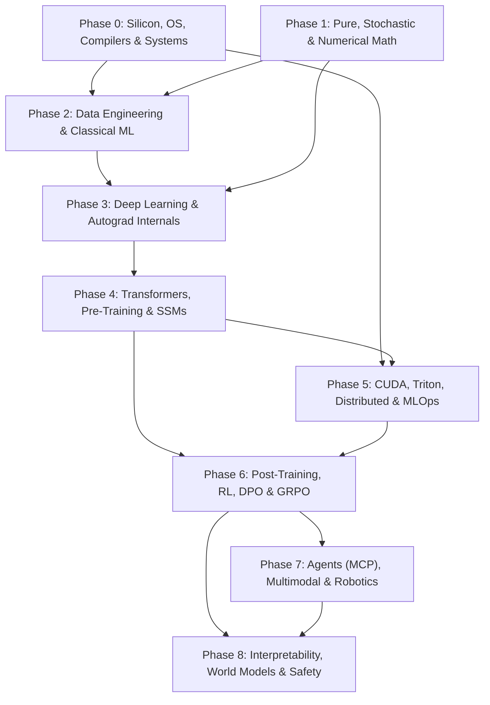

# 🧠 The Complete AI, Systems & Frontier Intelligence Roadmap

> **Interactive Syllabus Portal:** Open `https://shashankshawak7.github.io/AI-Learning-Journey/` or [`docs/index.html`](./docs/index.html) locally in any browser.

---

## 🗺️ Dependency Architecture

---

## 📚 Phase · Module · Chapter Links

Each completed chapter provides **written notes (`.md`)**, an **interactive live session (`.html`)**, and a **narrated AI Tutor whiteboard video (`.mp4`)**.

### Phase 0: Silicon, OS, Compilers & Systems Programming

| Module | Chapter | Notes | Interactive Session | AI Tutor Video |
| :--- | :--- | :---: | :---: | :---: |
| **`M0.1`** Computer Architecture & Silicon Foundations | **Ch 01:** Binary, Hex, Two's Complement, Overflow, ASCII & UTF-8 | [Read Ch01](<./Phase 0 - Silicon, OS, Compilers & Systems Programming/M0.1 - Computer Architecture & Silicon Foundations/Ch01 - Binary, Hex, Two's Complement, Overflow, ASCII & UTF-8.md>) | [Live Lesson](<./Phase 0 - Silicon, OS, Compilers & Systems Programming/M0.1 - Computer Architecture & Silicon Foundations/assets/ch01-live-lesson.html>) | [Watch MP4 (3m 33s)](<./Phase 0 - Silicon, OS, Compilers & Systems Programming/M0.1 - Computer Architecture & Silicon Foundations/assets/ch01-infographic-video.mp4>) |
| **`M0.1`** Computer Architecture & Silicon Foundations | Ch 02–Ch 10 (IEEE 754, ALU, SIMD, Caches, TLB, NVLink, FP8/CXL) | _Upcoming_ | _Upcoming_ | _Upcoming_ |
| **`M0.2`** Operating Systems, Compilers & IR Lowering | Processes, Syscalls, Atomics, `io_uring`, AST/SSA, MLIR & TVM/XLA | _Upcoming_ | _Upcoming_ | _Upcoming_ |
| **`M0.3`** Python Mastery & Systems Programming | Python Internals, C/C++20, Rust, `nanobind` / `PyO3`, No-GIL | _Upcoming_ | _Upcoming_ | _Upcoming_ |
| **`M0.4`** Data Structures, Algorithms & Complexity | Trees, Graphs, DP, Sketches, HNSW / IVF-PQ, DiskANN | _Upcoming_ | _Upcoming_ | _Upcoming_ |

### Phases 1–8 Overview (Modules Ready for Authoring)

| Phase | Modules | Notes | Interactive Session | AI Tutor Video |
| :--- | :--- | :---: | :---: | :---: |
| **Phase 1: Pure, Stochastic & Computational Math** | `M1.1` Logic/Proofs · `M1.2` Linear Algebra · `M1.3` Calculus/SDEs · `M1.4` Info Theory | _Upcoming_ | _Upcoming_ | _Upcoming_ |
| **Phase 2: Data Engineering & Classical ML** | `M2.1` Lakehouse/MinHash · `M2.2` Tabular SOTA · `M2.3` Learning Theory & Causality | _Upcoming_ | _Upcoming_ | _Upcoming_ |
| **Phase 3: Deep Learning & Autograd** | `M3.1` Backprop/Init · `M3.2` PyTorch/JAX/Compilers · `M3.3` Vision/Seq/Graph/Flow | _Upcoming_ | _Upcoming_ | _Upcoming_ |
| **Phase 4: Transformers & Pre-Training** | `M4.1` Tokenization · `M4.2` Attention/RoPE/MLA · `M4.3` Scaling Laws · `M4.4` MoE/SSMs | _Upcoming_ | _Upcoming_ | _Upcoming_ |
| **Phase 5: GPU Computing & Serving** | `M5.1` GPU Arch · `M5.2` CUDA/Triton · `M5.3` 5D Parallel · `M5.4` Quant/Serving · `M5.5` MLOps | _Upcoming_ | _Upcoming_ | _Upcoming_ |
| **Phase 6: Post-Training, RL & Reasoning** | `M6.1` SFT/LoRA · `M6.2` Deep RL · `M6.3` RLHF/DPO · `M6.4` GRPO & Test-Time Compute | _Upcoming_ | _Upcoming_ | _Upcoming_ |
| **Phase 7: RAG, Agents, Multimodal & Robotics** | `M7.1` Hybrid/GraphRAG · `M7.2` MCP/Sandboxes · `M7.3` VLM/Audio/Video · `M7.4` Control/VLA | _Upcoming_ | _Upcoming_ | _Upcoming_ |
| **Phase 8: Interpretability, World Models & Safety** | `M8.1` Mech Interp · `M8.2` World Models/JEPA · `M8.3` AI Safety · `M8.4` Evals & Rigor | _Upcoming_ | _Upcoming_ | _Upcoming_ |

---

## 🎯 8 Specialization Tracks (Pursue After Phase 4)

| Track | Role | Core Phases | Focus |
| :--- | :--- | :--- | :--- |
| **Track A** | Frontier LLM Researcher | `P1 · P3 · P4 · P6 · P8` | Pre-training scaling laws, MLA/MoE/SSM architectures, GRPO reasoning, mechanistic interpretability, and novel benchmark evaluation. |
| **Track B** | AI Systems & Inference Engineer | `P0 · P3 · P4 · P5` | C++/Rust runtimes, CUDA/Triton/CUTLASS kernels, PagedAttention, FP8/FP4 quantization, speculative decoding, and serving engines. |
| **Track C** | Autonomous Agent Architect | `P2 · P4 · P6 · P7` | ReAct/LATS planning, MCP/A2A protocols, grammar-constrained outputs, episodic/GraphRAG memory, and Firecracker microVM sandboxing. |
| **Track D** | Multimodal AI Researcher | `P1 · P3 · P4 · P7` | Vision-Language Models (SigLIP/CLIP), audio codecs, native omni-modal streaming, Rectified Flow Matching, and video diffusion. |
| **Track E** | Robotics & Embodied Intelligence | `P0 · P1 · P3 · P7` | SE(3) kinematics, MPC/LQR control theory, SLAM/Gaussian Splatting, Diffusion Policy, VLA models (pi0), Isaac Sim, and ROS 2. |
| **Track F** | Distributed AI Infrastructure Engineer | `P0 · P2 · P5` | InfiniBand/NVLink clusters, NCCL collectives, 5D parallelism, Slurm/K8s GPU scheduling, SDC fault tolerance, and observability. |
| **Track G** | Neuro-Symbolic & Alt Intelligence | `P1 · P3 · P4 · P6 · P8` | Formal logic, Lean 4 theorem proving, GNNs, physics-informed nets, evolutionary/Hebbian learning, and JEPA world models. |
| **Track H** | Applied & Enterprise AI Architect | `P0 · P2 · P5 · P7` | Lakehouse data pipelines, industrial Hybrid/GraphRAG, PEFT/LoRA, model routing, MLOps/LLMOps, cost economics, and governance. |
